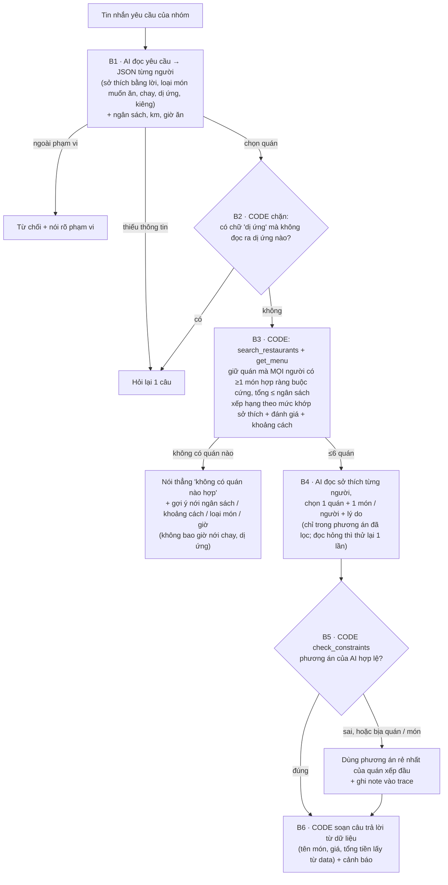

# AI SPEC — [Tên lát cắt] · Nhóm [tên nhóm] · Phòng [XXX] · Zone [X]

> Mốc nộp: §7 chốt chuẩn "đạt" tại **CP2 19:30 Thứ Sáu 27/11** · §0–§7 nộp **CP3 10:00 Thứ Bảy 28/11** · đủ §0–§10 **CP4 14:30 Thứ Bảy 28/11** · §10 changelog ghi tiếp đến **23:59 Thứ Bảy 28/11**.
> Đầu mỗi mục ghi bước guide (`02-guide.md` trong repo đề) chỉ cách điền. Mỗi mục ngắn, có số và nguồn; chi tiết để ở file được trỏ tới. Xoá dòng hướng dẫn trong ngoặc vuông khi điền xong.

Track: [ ] A · [ ] B · [ ] C · [x] D · [ ] E — bài toán: chọn quán và món cho nhóm mỗi người một ý (mở rộng từ gợi ý D2 · đặt đơn nhóm)
Data BTC cấp đã dùng (nếu có — không commit nguyên file): không dùng

## §0. Hiện tại việc này diễn ra thế nào *(guide 1.1)*
- Luồng hiện tại của việc này, trong khoá hoặc trên app thật (3–5 bước; ảnh chụp từ tài khoản của mình, đã che thông tin):
- Công cụ / AI đang được dùng cho việc này (nếu có) + nguồn. Không kiểm được thì ghi "chưa kiểm":

## §1. Người dùng & bằng chứng *(guide 1.1, 1.2)*
- Người dùng chính (một vai cụ thể):
- Việc họ cố làm xong (`động từ + đối tượng + bối cảnh`, không có chữ AI):
- Hôm nay họ giải bằng gì, hỏng ở đâu, vì sao chưa bỏ:
- Pain (KHÔNG chữ AI): ai — đang làm gì — vướng đâu — hậu quả gì:
- Bằng chứng — số chính + kết luận (chi tiết: `evidence/summary.md`): __

## §2. Impact & quyết định chọn *(guide 1.3)*

| Hướng | Bao nhiêu người gặp | Bao nhiêu lần / tháng | Mỗi lần tốn gì | Impact / tháng | Làm kịp không | Chọn? |
|---|---|---|---|---|---|---|
|  |  |  |  |  |  |  |
|  |  |  |  |  |  |  |
|  |  |  |  |  |  |  |

- **Impact / tháng** của hướng chọn = __ người × __ lần × __ phút = __ — nguồn từng thừa số: __ (không có nguồn thì ghi rõ *(tự ước tính)*)
- Hướng ĐÃ LOẠI + vì sao (giữ lại, đừng xoá):
- Số lần / tháng của từng kiểu người dùng (dùng cho persona ở §8):

## §3. Giải pháp tương tự *(guide 2.1)*
- [sản phẩm / tính năng gần giống]: một điều đáng học · một điều đáng né · mình khác gì

## §4. Thiết kế *(guide 2.2, 3.2)*
- **Lát cắt MỘT CÂU:** Một người chọn quán cho nhóm 2–6 người **mỗi người một ý** (muốn ăn gì, không ăn gì, ngân sách, khoảng cách, giờ ăn; ăn chay hay dị ứng là phần phụ), nhắn bằng lời thường · AI hiểu sở thích của từng người và chọn **một quán + một món cho từng người** trong các phương án code đã lọc · người đó nhận quán, món, tổng tiền và lý do, hoặc nghe nói thẳng "không có quán nào hợp" kèm gợi ý nên nới yêu cầu nào.
- **Không làm:**
  1. Không đặt đơn, không thanh toán. Người dùng tự đặt.
  2. Không gom đơn, không chia tiền giữa các thành viên.
  3. Không gợi ý quán hay món ngoài dữ liệu `data/restaurants.json`.
  4. Không tư vấn dinh dưỡng, không chẩn đoán dị ứng, không khẳng định món "an toàn" với người dị ứng.
  5. Không tính phí ship (data không có), không theo dõi quán mở hay đóng theo thời gian thực.
  6. Backend xử lý mỗi tin độc lập. Bot hỏi lại thì giao diện ghép câu bổ sung với yêu cầu trước rồi gửi lại.
- **Sơ đồ** (khớp `codebase/agent.py`, B1–B6):

- **Hình dạng:** [x] workflow cố định · [ ] một agent · [ ] nhiều agent
  - **Lý do:** các bước luôn đi cùng một thứ tự (đọc yêu cầu → lọc → chọn → kiểm), không cần AI tự quyết bước tiếp theo. Workflow cố định giúp đặt được chỗ chặn bằng code **trước và sau** mỗi lần gọi AI.
  - **Vì sao không chọn agent tự lặp:** 40 quán và khoảng 1.200 món. Nếu để agent tự gọi công cụ thì dễ tự nhẩm tiền, bỏ sót người trong nhóm, hoặc gọi công cụ lan man rất tốn token. Lọc bằng code trước rồi mới đưa khoảng 6 quán cho AI thì rẻ hơn và kiểm soát được. Nhiều agent lại càng không cần: không có hai vai nào thật sự khác nhau.
- **AI dựa vào đâu** (khớp `codebase/tools.py`):

  | Công cụ | Input | Output | Tác động ra ngoài? |
  |---|---|---|---|
  | `search_restaurants` | `max_distance_km` · `name` (quán người dùng nhắc) · `at_time` ("HH:MM") | quán `{id, ten, khoang_cach_km, danh_gia, gio_mo, mo_cua}`; quán chắc chắn đóng cửa lúc đó bị loại | Không, chỉ đọc |
  | `get_menu` | `restaurant_id` | món chính `{id, ten, gia, loai, nhom, mo_ta, chay, co_nhac, thit, ghi_thanh_phan}` | Không, chỉ đọc |
  | `check_constraints` | phương án `{quan_id, chon[]}` · ràng buộc từng người · ngân sách · km · giờ | `{ok, vi_pham[], tong_tien}` | Không, chỉ tính. **Chạy bằng code, không phải AI** |

  Hai lần gọi AI: **B1** đọc tin nhắn lộn xộn của cả nhóm thành ràng buộc từng người, **B4** hiểu sở thích bằng lời ("đồ có nước", "không muốn đồ chiên") và khớp vào tên món thật để chọn quán và món. Đây là việc bộ lọc của app không làm được.
- **Mức tự động:** [x] AI gợi ý, người quyết · [ ] AI tự làm khi chắc, chuyển người khi không · [ ] AI tự làm
  - **Lý do:** AI chỉ gợi ý, người dùng tự quyết có đặt quán đó không. Gợi ý không hợp thì người dùng chọn lại, sửa rẻ. Những chỗ sai đắt (vượt ngân sách, quán không có thật, món có chất người đó dị ứng) do code chặn.
- **Chỗ chặn rủi ro:** rủi ro lớn nhất là **gợi ý quán hoặc món không có thật, hoặc sai số tiền**, khiến cả nhóm đặt theo một thông tin sai. Phụ hơn là gợi ý món có chất người đó dị ứng. Chặn ở 4 lớp:
  1. B4 chỉ nhận các quán và món B3 đã lọc. B5 `check_constraints` bắt quán hay món bịa, vượt ngân sách, sai ràng buộc. Sai thì bỏ, dùng phương án code đã kiểm.
  2. B6 lấy tên món, giá, tổng tiền từ data, không lấy từ chữ của model.
  3. Dị ứng: `dish_ok_for` loại món có **nhắc** chất đó trong tên hoặc mô tả. Vì menu không ghi đủ thành phần (40,5% món trên Grab không có mô tả), câu trả lời luôn kèm cảnh báo "hỏi quán trước khi đặt". Ăn chay: chỉ món có ghi "chay".
  4. B2: nhắc dị ứng mà không rõ dị ứng gì thì hỏi lại, không đoán. Lớp này chặn luôn câu "kệ dị ứng đi".
- **Chỗ người duyệt:** việc đặt đơn và thanh toán do người dùng tự làm. Hệ thống không có công cụ nào tác động ra ngoài.
- **Nguyên tắc thiết kế:**

  | Nguyên tắc | Chỗ cụ thể trên sơ đồ / trong bản chạy thử |
  |---|---|
  | G10 — thu hẹp phạm vi khi không chắc | B2: không rõ dị ứng gì thì hỏi lại · `dish_ok_for`: món không ghi "chay" thì không coi là chay · B3: không có quán nào hợp thì nói "không có", không xếp bừa · quán không ghi giờ mở cửa thì cảnh báo kiểm tra lại |
  | Số liệu chỉ lấy từ công cụ, tính bằng code | B3 tính tổng tiền, B6 lấy tên món, giá, tổng tiền từ data. Chữ của model chỉ dùng cho phần "Lý do" |
  | Chỉ chọn trong tập đã lọc, kiểm lại sau AI | B4 chỉ thấy ≤6 quán B3 đã lọc · B5 `check_constraints` bắt quán hay món bịa, vượt ngân sách |
  | Tin nhắn là dữ liệu, không phải lệnh | `SYSTEM_PARSE`: bỏ qua yêu cầu đổi vai, "bỏ qua hướng dẫn", "kệ dị ứng" · quán người dùng chỉ định mà không có trong data thì trả "không có" |
  | Không bao giờ nới ràng buộc an toàn | `_relax_hint` chỉ gợi ý nới ngân sách, khoảng cách, loại món, giờ ăn, không bao giờ gợi ý bỏ chay hay dị ứng |

- **Phần còn giả hoặc giới hạn:**
  - `data/restaurants.json` là **dữ liệu dựng giả có seed** (40 quán, 1.207 món, tên quán dựng), sinh bằng `scripts/gen_synthetic.py` theo phân bố giá, khoảng cách, đánh giá, tỉ lệ món có mô tả **đo từ menu thật trên GrabFood** do nhóm crawl. Data crawl chỉ dùng làm bằng chứng và để đo số liệu, không commit. Nhãn chay, dị ứng, loại món gắn bằng từ khoá. Xem `data/DATA_CARD.md`.
  - Khoảng cách là số sinh theo phân bố của data thật, không tính theo vị trí người dùng. Không có phí ship.
  - **Chế độ giả** (chưa có `MODEL_PROVIDER` trong `.env`): B1 dùng ràng buộc mẫu cố định `FAKE_PARSE`, bỏ qua tin nhắn. Output ghi rõ `[chế độ giả …]`. Lượt eval chạy ở chế độ này không được tính.

## §5. Chỗ khó — 4 lớp + ≥6 kịch bản + 2 tấn công *(guide 2.3)*

| Kịch bản | Lớp (1–4) | Hành vi mong muốn (nói gì, hiện gì, cho làm gì tiếp) | Câu thử |
|---|---|---|---|
|  |  |  |  |
| *(tấn công)* |  |  |  |
| *(tấn công)* |  |  |  |

(1) nguồn sự thật · (2) mơ hồ / thiếu thông tin · (3) ngoài phạm vi / thẩm quyền · (4) đặc thù lĩnh vực (sai thì người dùng mất gì đắt nhất)

## §6. Bốn đường đi của trải nghiệm
- Mọi thứ suôn sẻ: · Không chắc (lớp 2): · Không có căn cứ (lớp 1): · Người dùng sửa:
- Bị đòi ngoài phạm vi (lớp 3): · Trường hợp đặc thù lĩnh vực (lớp 4):

## §7. Đánh giá & chuẩn "đạt" *(guide 2.4, 4.1)*
- Data card: `data/DATA_CARD.md` · bộ câu thử: `eval/benchmark.csv` — __ câu (thuong __ · kho __ · tu_choi __) · metric: `eval/metric_spec.yaml` (__ metric)
- **Chuẩn "đạt"** (chốt **trước 19:30 Thứ Sáu 27/11**, giữ nguyên đến 23:59 Thứ Bảy 28/11): "Đạt khi ≥ __% câu qua, và __"
- Kết quả: lượt 1 __/__ (__%) · lượt 2 __/__ (__%) — run ID: __ / __ → chi tiết `eval/report.md`, hồ sơ `eval/README.md`

## §8. Chi phí khi dùng thật *(guide 4.2)*
- Persona + giá: `cost/personas.yaml` · lượt mô phỏng: `cost/simulate-__.csv` (__ phiên)
- Chi phí / task thành công: __ (model __) · __ (model __)
- Chi phí / tháng ở quy mô thật: thấp __ · cơ sở __ · cao __ → chi tiết `cost/cost-estimate.md`
- So với impact / người / tháng (§2): đáng làm không, vì sao:

## §9. Rủi ro & an toàn
- Dữ liệu: đã ẩn danh gì, không thu gì, không đưa gì vào model gói miễn phí:
- AI **không được** làm gì kể cả khi người dùng yêu cầu:
- Ai có thể bị hại nếu AI sai, và nhóm chặn thế nào:

## §10. Phân công & changelog
- Phân công có tên (theo chặng, chia cặp — guide "Cách chia việc"): __
- Dùng AI vào việc gì (2–3 dòng; chi tiết `docs/ai-usage.md`):
- Nhật ký thay đổi — **mọi thay đổi sau CP2 19:30 Thứ Sáu 27/11 phải có dòng ở đây**:

**CP2 → CP4** (vd thu hẹp lát cắt, hỏi thêm người dùng, lần cải tiến trước lượt 2)

| Thời điểm | Đổi gì | Vì sao (trỏ về câu thử / lỗi / bằng chứng nào) |
|---|---|---|
|  |  |  |

**Sau CP4 (đến 23:59 Thứ Bảy 28/11)** (sửa theo góp ý — không sửa chuẩn "đạt", câu thử, số bằng chứng, kết quả các lượt đã chạy)

| Thời điểm | Đổi gì | Vì sao |
|---|---|---|
|  |  |  |
